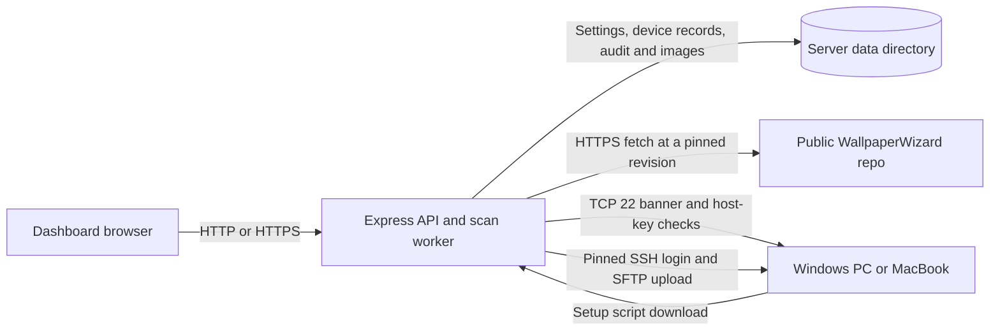

# WallpaperWizard architecture

WallpaperWizard is a self-hosted dashboard that discovers Windows PCs and MacBooks on configured network ranges and applies wallpapers over SSH. Run the setup command on each managed device once, then manage assignments from the dashboard.

## Components and communication

| Component | Responsibility |
| --- | --- |
| React dashboard | First-run setup, sign-in, wallpaper uploads and schedules, device approval, settings, worker status, and change logs. |
| Express server and worker | Serve the UI and APIs, apply role checks, save settings, scan the configured ranges, resolve assignments, and track push results. |
| Data directory | Store `db.json`, uploaded images, and the generated encryption key when an external key is unavailable. The Docker deployment mounts this directory at `/app/data`. |
| Windows PowerShell setup | Check `.\ithelpdesk`, enable OpenSSH, and add the Windows discovery marker. The service restarts when its discovery configuration changes. |
| MacBook shell setup | Check `ithelpdesk` and the Mac hardware model, enable Remote Login, and add the MacBook discovery marker. Setup can open the Full Disk Access approval pane if macOS requests it. |

The browser connects to the app's HTTP or HTTPS origin. The default ports are 3000 for the local Node server and 8080 for Docker Compose. For each setup script, the server fetches the pinned revision from the public WallpaperWizard GitHub repository on the first successful request and keeps it in memory. The dashboard origin supplies the client URLs unless the deployment sets `WW_SETUP_BASE_URL`. After setup, the server needs outbound TCP 22 to the managed device, and the device's firewall must allow that connection.

## Discovery and delivery

1. The worker expands the configured IPs and IPv4 CIDR ranges and reads the SSH banner on port 22. A matching public platform marker qualifies the host for discovery.
2. WallpaperWizard reads the host key without sending device credentials. The key's SHA-256 fingerprint identifies the device across IP changes. New devices wait for approval.
3. The worker chooses the active, in-schedule wallpaper that most specifically targets the device. A device assignment takes priority over a group assignment, then an organization assignment. At the same priority, the most recently updated wallpaper wins.
4. For an approved device, the server checks the pinned host key before authentication. It signs in as `.\ithelpdesk` on Windows or `ithelpdesk` on macOS. The authenticated session must match the local account and have administrator privileges before any files are changed.
5. The server copies the image over SFTP. Windows registers a scheduled task that applies the image in the interactive user's session and at sign-in. macOS uses the signed-in desktop session to apply it through System Events. When nobody is signed in on a MacBook, the worker retries on a later cycle.
6. The dashboard reports the last result and tracks the applied wallpaper version. A forced push resends the current assignment. A scheduled cycle also scans periodically and applies due assignments.

## Access and storage

- Dashboard sessions and roles govern who can configure the app. Superadmins manage credentials, discovery settings, approvals, users, access restrictions, and the audit log. Editors can manage wallpaper assignments and request pushes to approved devices.
- The discovery marker is public. Device approval and the pinned host fingerprint govern delivery. Client OS settings manage personal wallpaper permissions and SSH access for other accounts.
- The device password is encrypted with AES-256-GCM. With Docker, back up the data volume. When using `WW_SECRET_KEY`, retain it through your normal secret backup procedure so restored passwords remain usable.
- An upgrade reuses a saved password for the required local ithelpdesk account. If the previous installation used a different username, save the ithelpdesk password in Push Settings.

## Basic troubleshooting

| Symptom | Check |
| --- | --- |
| Device is missing after a scan | Confirm the device is in the configured range, TCP 22 is reachable from the server, and the current setup script printed its discovery marker. |
| Windows setup stops at the account check | Confirm `.\ithelpdesk` exists, is enabled, and belongs to the local Administrators group. Run the setup command in elevated Windows PowerShell. |
| MacBook setup stops at the account check | Confirm `ithelpdesk` is a local administrator under Users & Groups. Allow it in Remote Login under Sharing and rerun the script. |
| macOS requests Full Disk Access during setup | Approve Terminal in Privacy & Security, quit and reopen it, and rerun setup. You can also enable Remote Login directly under Sharing. |
| macOS requests System Events during the first push | Choose Allow on the Mac. A previous decision can be changed under Privacy & Security → Automation. Retry the push after approval. |
| Host key changed | Verify the device and its new SSH host key through your normal admin process. Discover and approve the new record after confirming its identity. |
| A push reports authentication or account failure | Verify the password in Push Settings, the local account's administrator rights, and its SSH access. Check Last push on the device row for the failure message. |
| No image appears after a push | Check the current schedule and assignment. Check Last push and confirm an interactive user is signed in. Use Push to resend the active assignment. |
| Setup command cannot reach the server | Open the dashboard through its LAN address or deployment hostname, then copy the current command. If a branded origin is configured, verify that it routes both setup paths to WallpaperWizard. |
| Setup download returns HTTP 502 | Check whether the WallpaperWizard server can reach `raw.githubusercontent.com` over HTTPS, then retry. |

## Source map

- [Express API, scanner, and worker](server.ts)
- [SSH host-key verification and wallpaper delivery](devicePush.ts)
- [Wallpaper assignment resolution](src/shared/resolveWallpaper.ts)
- [Discovery marker checks](src/shared/deviceDiscovery.ts)
- [Setup download URLs](src/shared/setupScripts.ts)
- [Windows setup](public/setup/windows.ps1) and [MacBook setup](public/setup/macos.sh)
